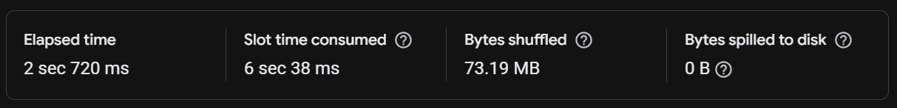

# Email SQL Query Optimization

## Project Overview

In this project, I worked on improving an SQL query in Google BigQuery.

The query calculates email marketing metrics for different operating systems. My goal was to make the query easier to read and improve its performance.

I compared the original and updated SQL queries using BigQuery Execution Details.

## Tools

- Google BigQuery
- SQL
- GitHub

## Email Metrics

The query calculates:

- **Sent Emails** — number of unique sent emails.
- **Opened Emails** — number of unique opened emails.
- **Email Clicks** — number of unique emails with link visits.
- **Open Rate** — percentage of sent emails that were opened.
- **Click Rate** — percentage of sent emails with link visits.
- **CTOR** — percentage of opened emails with link visits.

All metrics are grouped by operating system.

## What I Changed

I made several changes to the original SQL query:

1. Removed unnecessary columns and subqueries.
2. Made the JOIN structure easier to understand.
3. Used a CTE to calculate email metrics.
4. Calculated email rates using the results from the CTE.
5. Used `SAFE_DIVIDE` to avoid division by zero.

## Performance Comparison

I used BigQuery Execution Details to compare both SQL queries.

| Metric | Original Query | Updated Query | Difference |
|---|---:|---:|---:|
| Execution Time | 2.720 s | 0.685 s | -74.8% |
| Slot Time | 6.038 s | 2.002 s | -66.8% |
| Bytes Shuffled | 73.19 MB | 0 B | -100% |
| Bytes Processed | 59.75 MB | 59.75 MB | 0% |

These values are from individual query runs. The results show lower execution time and slot time in the updated query, but more tests are needed to confirm a stable performance improvement.

## Execution Details

### Before Optimization

### After Optimization

## SQL Files

- [Original SQL Query](sql/original_query.sql)
- [Updated SQL Query](sql/optimized_query.sql)

## Conclusion

In this project, I learned how to improve SQL code and compare query performance in Google BigQuery.

The updated query is easier to read and showed better execution time in my tests.

I also learned that shorter SQL code does not always mean better performance. It is important to check the results in Execution Details.
